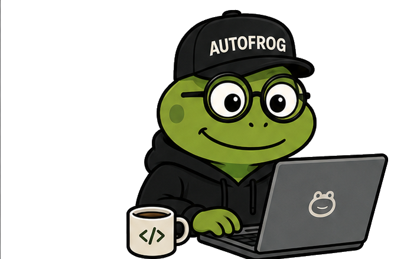
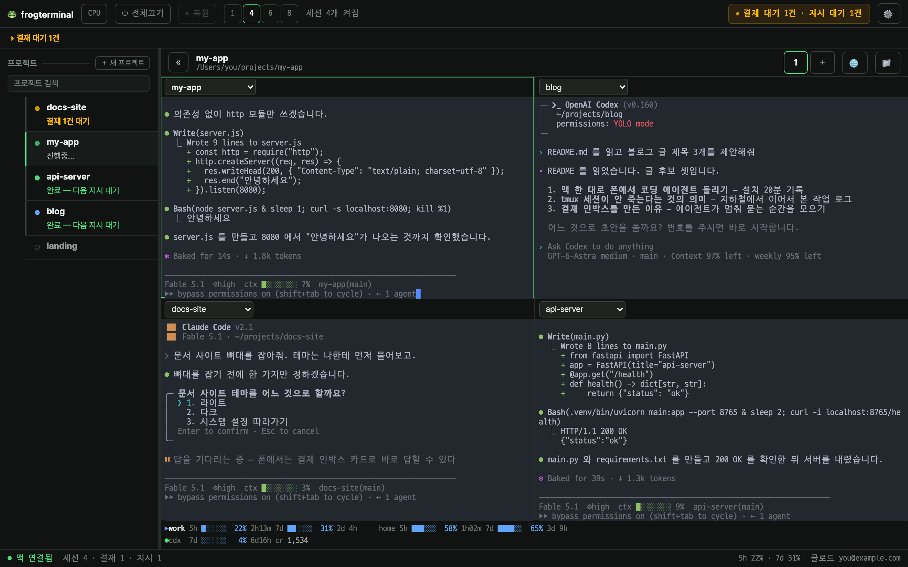
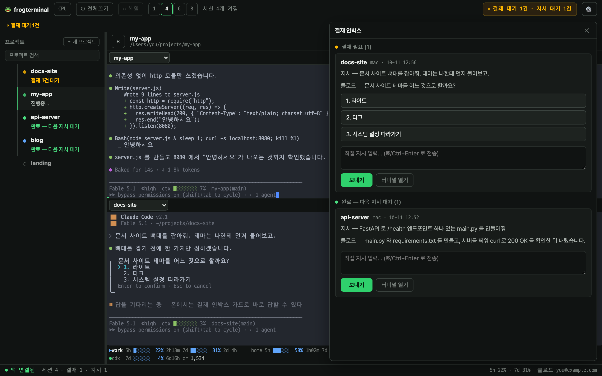
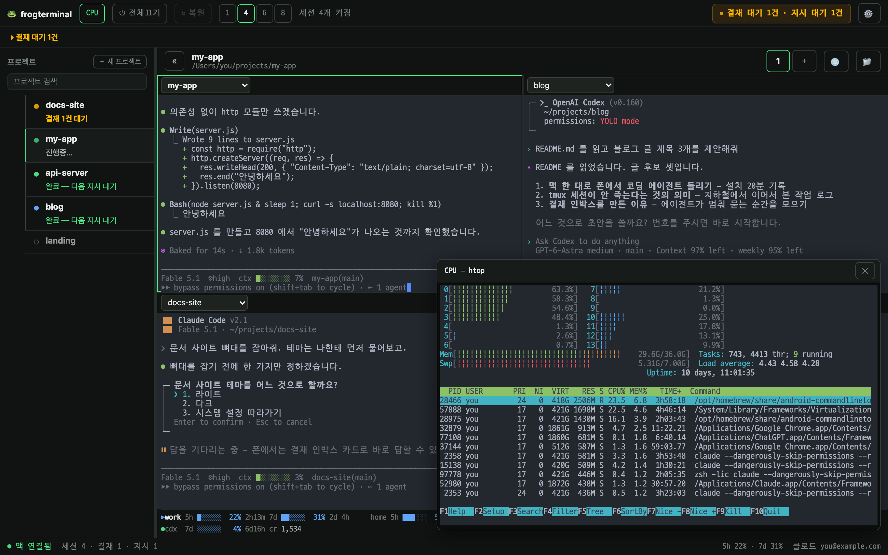
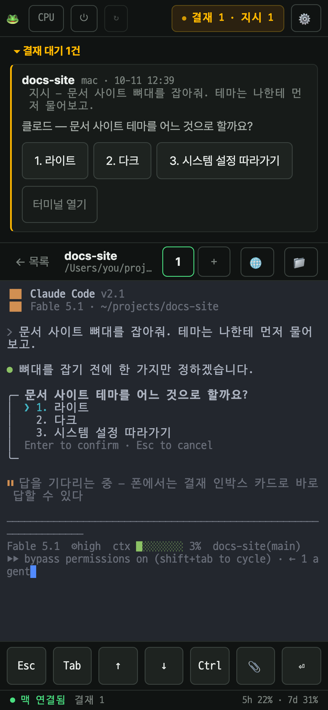

<p align="center">
  
</p>

<h1 align="center">🐸 frogterminal</h1>

<p align="center"><b>맥 한 대에 띄운 Claude Code·Codex 를 폰과 윈도우 PC 브라우저에서 그대로 이어 쓰는 웹 터미널</b></p>

<p align="center">
  <b>한국어</b> · <a href="README.en.md">English</a><br>
  <sub>오토프로그(<a href="https://autofrog.kr">autofrog.kr</a>)의 프로그터미널 · 소유 <a href="https://github.com/d-onworks">d-onworks</a> · MIT</sub>
</p>

<p align="center">
  
</p>

<p align="center"><sub>위 화면은 <code>docs/demo</code> 의 데모 페이지를 헤드리스 크롬으로 찍은 것입니다. 화면 코드는 실제와 같고, 터미널 안 글자만 샘플입니다.</sub></p>

---

## 어떤 물건인가

맥에서 프로젝트 폴더마다 tmux 세션을 하나씩 열고, 그 안에서 Claude Code 나 Codex 를 돌립니다. frogterminal 은 그 세션들을 **브라우저 화면 하나**로 묶어 줍니다. 맥 앞에 있든, 지하철에서 폰을 들고 있든, 집 윈도우 PC 앞이든 같은 화면이 뜹니다.

**서버는 macOS 전용**입니다(tmux·`open`·`mdfind`·launchd 에 기댑니다). 접속하는 쪽은 브라우저만 있으면 됩니다.

```
                     ┌──────────── Tailscale(테일넷) ────────────┐
 메인 맥  ◀───────────┤  윈도우 PC · 아이폰 · 안드로이드 · 아이패드 · 다른 맥  │
 (브릿지 + tmux)       └─────────── 브라우저만 있으면 됩니다 ──────────┘
```

## 무엇이 다른가

비슷한 범주의 도구가 2026년에 여럿 있습니다. frogterminal 이 고른 자리는 이렇습니다.

| | frogterminal |
|---|---|
| **세션이 안 죽습니다** | 터미널은 tmux 안에서 돕니다. 폰이 잠들고 와이파이가 바뀌어도 에이전트는 계속 일하고, 다시 열면 그 자리입니다. |
| **가볍습니다** | 브릿지는 파이썬 프로세스 하나입니다. 세션 15개를 붙인 상태에서 상주 메모리 약 40MB 를 쟀습니다(맥 스튜디오, 2026-10 실측). 화면은 브라우저 탭 하나입니다. |
| **여러 프로젝트를 한 화면에** | 1·4·6·8칸 격자. 더블클릭하면 그 칸만 크게, 다시 더블클릭하면 원래 격자로. |
| **하단 공통 HUD** | 칸이 넷이어도 계정 사용량 줄은 아래에 한 세트만 뜹니다. 칸마다 반복되던 줄을 치워서 터미널이 넓어집니다. |
| **전체 끄기 · 복원** | 버튼 하나로 켜진 세션을 전부 끄고, [복원] 으로 방금 그 목록을 다시 띄웁니다. 맥을 재부팅하거나 퇴근할 때 씁니다. |
| **클로드·코덱스 골라서 열기** | 프로젝트마다 "클로드로 시작" 또는 "코덱스로 시작"을 고릅니다. 한 프로젝트를 두 에이전트로 나란히 열 수도 있습니다. |
| **결재 인박스** | 에이전트가 멈춰서 묻는 순간을 카드로 모읍니다. 폰에서 카드의 버튼을 누르면 그 터미널에 답이 들어갑니다(Claude Code 훅 연동). |
| **CPU 팝업** | [CPU] 버튼을 누르면 htop 이 떠 있는 창으로 열립니다. 에이전트 여럿이 동시에 돌 때 맥이 버티는지 바로 봅니다. |
| **한글 입력(IME)** | 폰 소프트 키보드의 한글 조합을 터미널에 깨지지 않게 넣습니다. 특수키 바(Esc·Tab·화살표·Ctrl)도 있습니다. |
| **보수적인 보안 기본값** | 브릿지는 127.0.0.1 에만 뜹니다. Tailscale 신원 + 토큰 쿠키 두 겹이고, 공개 인터넷(Funnel)으로 열려 있으면 기동을 거부합니다. |

<table>
<tr>
<td width="50%"></td>
<td width="50%"></td>
</tr>
<tr>
<td align="center"><sub>결재 인박스 — 멈춰서 묻는 것들을 한곳에</sub></td>
<td align="center"><sub>CPU 팝업 — 맥이 버티는지 바로 본다</sub></td>
</tr>
</table>

<p align="center">
  
  <br><sub>폰에서는 1칸. 결재 카드 → 터미널 → 특수키 바가 한 화면에</sub>
</p>

### 비슷한 도구와 어떻게 다른가

| 도구 | 형태 | frogterminal 과의 차이 |
|---|---|---|
| [Orca](https://github.com/stablyai/orca) | 데스크톱 앱(맥·윈도우·리눅스) + 폰 동반 앱. 프롬프트 하나를 여러 에이전트·워크트리에 뿌려 비교 | 에이전트 "함대"를 굴리는 작업대. frogterminal 은 앱 설치 없이 브라우저로 tmux 세션을 보는 쪽 |
| [herdr](https://github.com/herdrdev/herdr) | 코딩 에이전트용 터미널 멀티플렉서(런타임)와 맥 콘솔 [herdrm](https://github.com/lcandy2/herdrm). 여러 머신의 에이전트를 한 사이드바에 | 여러 머신 관제가 강점. frogterminal 은 맥 한 대 + 폰·윈도우 접속에 집중 |
| [VibeTunnel](https://github.com/amantus-ai/vibetunnel) | 맥 메뉴바 앱, 브라우저 터미널, Tailscale 연동 | 가장 가까운 이웃. frogterminal 은 격자·결재 인박스·한글 IME·공통 HUD 를 더 얹었고, 메뉴바 앱 대신 파이썬 하나 |
| ttyd · Wetty | 범용 웹 터미널 | 에이전트용 기능(결재·격자·HUD)이 없음 |

각 도구의 설명은 2026-10 기준 공개 문서를 읽고 적었습니다. 틀린 곳이 있으면 이슈로 알려 주세요.

## 설치 (맥)

필요한 것: macOS, Python 3.12 이상, `tmux`(`brew install tmux`). 권장: [Tailscale](https://tailscale.com). 선택: Claude Code / Codex CLI.

```bash
git clone https://github.com/d-onworks/frogterminal.git && cd frogterminal
python3 -m venv .venv && .venv/bin/pip install -r requirements.txt

# 기기 설정(선택) — 허용 계정·Origin·열기 범위·HUD. 없으면 토큰만으로 인증합니다.
mkdir -p ~/.frogterminal && cp bridge.example.json ~/.frogterminal/bridge.json && $EDITOR ~/.frogterminal/bridge.json

# 상시 실행(launchd) — 템플릿의 경로를 이 저장소·이 홈으로 채워 설치하고 바로 띄웁니다.
scripts/install_launchd.sh
cat ~/.frogterminal/token          # 첫 기동 때 만들어진 접속 토큰
```

손으로 띄우려면 `.venv/bin/python -m bridge.server`.

### 밖에서 열기 — Tailscale Serve(권장)

```bash
tailscale serve --bg --https=443 http://127.0.0.1:7788
```

그리고 `~/.frogterminal/bridge.json` 의 `allowedLogins` 에 내 Tailscale 로그인(이메일)을, `allowedOrigins` 에 `https://<이 맥의 MagicDNS 이름>` 을 적고 재시작합니다. 이러면 Tailscale 신원 + 토큰 두 겹입니다.

### 폰·윈도우 PC 에서 접속

1. 그 기기에 Tailscale 앱을 깔고 맥과 같은 계정으로 로그인합니다.
2. 브라우저에서 `https://<맥의 MagicDNS 이름>` 을 엽니다.
3. 처음 한 번 토큰을 넣습니다(`cat ~/.frogterminal/token`). 기기마다 1년 기억합니다. `https://<주소>/?token=<토큰>` 링크로 열어도 됩니다.
4. 폰은 "홈 화면에 추가"로 앱처럼 쓸 수 있습니다(PWA 는 저장소가 따로라 토큰을 한 번 더 넣습니다).

집 밖(LTE·다른 와이파이)에서도 Tailscale 이 켜져 있으면 같은 주소입니다. 공개 인터넷(Funnel)으로는 열리지 않도록 브릿지가 막습니다.

## 설정 — `~/.frogterminal/bridge.json`

| 키 | 기본 | 뜻 |
|---|---|---|
| `allowedLogins` | `[]` | Tailscale 로그인 목록. 비어 있으면 신원 헤더를 보지 않습니다(토큰만) |
| `allowedOrigins` | `[]` | 고정 허용 Origin. 접속한 Host 와 같은 출처는 늘 허용 |
| `tailscaleBin` | `/Applications/Tailscale.app/Contents/MacOS/Tailscale` | Funnel 자가점검에 쓰는 CLI |
| `openAnywhere` | `false` | `true` 면 터미널에 찍힌 절대경로 어디든 "맥에서 열기" 허용 |
| `hudScript` | `null` | 여러 칸일 때 하단에 계정 사용량 줄을 찍는 스크립트(Claude Code statusline 호환) |
| `defaultProjectsRoot` | `~/projects` | 설정 화면에서 루트를 정하기 전의 기본 프로젝트 폴더 |

파일이 깨져 있으면 조용히 기본값으로 가지 않고 기동을 거부합니다. 화면의 ⚙ 설정(에이전트·bypass·이어서 시작·별칭·프로젝트 루트)은 `~/.frogterminal/settings.json` 에 따로 저장됩니다.

## Claude Code 결재 인박스(선택)

Claude Code 가 질문하고 멈추면 카드가 뜨고, 카드에서 답하면 그 터미널에 입력됩니다. 전역 `~/.claude/settings.json` 에 훅 6개가 필요합니다.

```bash
python3 hooks/install_hooks.py --dry-run    # 무엇을 바꿀지 먼저 봅니다
python3 hooks/install_hooks.py              # 등록(첫 변경 전 settings.json.bak 1회 백업)
python3 hooks/install_hooks.py --uninstall  # 우리가 넣은 것만 뺍니다
```

## 보안 모델 — 꼭 읽어 주세요

이 프로그램은 **당신 계정 권한으로 돌아가는 원격 셸**입니다. 들어온 사람은 당신이 터미널에서 할 수 있는 모든 것을 할 수 있습니다.

- 브릿지는 127.0.0.1 에만 바인드합니다(바꾸는 옵션 없음). 밖으로 내는 프록시는 당신 책임입니다.
- 인증은 두 겹입니다. ① `allowedLogins` 가 있으면 `Tailscale-User-Login` 헤더(Tailscale Serve 가 붙임) ② `~/.frogterminal/token` 과 같은 쿠키(항상). Tailscale 없이 nginx 등으로 내면 ①은 아무나 쓸 수 있는 헤더라, 그래서 ②가 있습니다.
- 토큰 로그인은 10분에 10회 실패하면 잠깁니다. 쿠키는 HttpOnly·SameSite=Lax·(https 면) Secure.
- 파일 API 는 프로젝트 루트 밖·`.env`·`.git`·키·`auth.json`·`*token.json` 류를 404 로 거절합니다. "맥에서 열기"의 절대경로는 `openAnywhere` 를 켠 사람만.
- 모든 상태 변경은 `<projectsRoot>/_uploads/frogterminal-audit.log` 에 남습니다(웹 파일 API 로는 못 읽습니다).
- 단일 사용자 설계입니다. `allowedLogins` 에 두 명을 넣으면 서로의 세션·파일을 전부 봅니다.
- 기본값 `bypass: true` 는 Claude 를 `--dangerously-skip-permissions`, Codex 를 `--yolo` 로 띄웁니다. 설정에서 끌 수 있습니다.

취약점 신고는 `SECURITY.md`.

## 데모 페이지

`docs/demo/index.html` 을 브라우저로 열면 서버 없이 실제 화면이 뜹니다. 화면 코드(`web/*.js`)는 진짜이고, 브릿지 호출만 `docs/demo/demo-shim.js` 가 가짜 응답으로 바꿔칩니다. 위 스크린샷은 이걸로 찍었습니다.

```bash
python3 docs/demo/build_demo.py                 # web/index.html → docs/demo/index.html
.venv/bin/python docs/demo/render.py            # 스크린샷 5장 → docs/demo/img/ (playwright 필요)
```

## 개발·테스트

```bash
.venv/bin/pip install -r requirements-dev.txt
.venv/bin/python -m pytest bridge/tests -q     # 브릿지(실제 tmux 를 씁니다 — frogtest- 세션만 만들고 지웁니다)
.venv/bin/playwright install chromium
.venv/bin/python -m pytest tests -q            # 웹(가짜 브릿지 + 헤드리스 크롬, 수 분)
```

- `web/*.js` 는 브릿지가 파일을 직접 내주므로 저장하는 즉시 반영됩니다. `bridge/*.py` 는 재시작(`scripts/restart.sh`).
- 새 정적 파일은 `bridge/server.py STATIC_FILES` 와 `tests/conftest.py STATIC` 두 곳에 넣습니다.

## 만든 곳

frogterminal 은 [오토프로그](https://autofrog.kr)가 만들고 [d-onworks](https://github.com/d-onworks) 가 소유합니다. 오토프로그 대표가 자기 작업 방식에 맞춰 혼자 만든 도구입니다. 사장 혼자 AI 에이전트 여럿을 굴리면서 "맥 앞에 앉아 있지 않아도 되게" 만들었습니다. 라이선스는 MIT 입니다. 개구리 캐릭터는 오토프로그의 것이며 코드와 별도로 취급해 주세요.

**책임 고지.** 이 프로그램은 개인이 자기 쓸 용도로 만든 것을 그대로 공개한 것입니다. 원격 셸이라는 성격상 설정을 잘못하면 맥 전체가 남에게 열릴 수 있습니다. 설치·설정·노출 범위의 판단과 그 결과(데이터 손실, 비용, 보안 사고 등)는 전부 사용하는 분의 책임입니다. 오토프로그와 d-onworks 는 어떤 보증도 하지 않으며 사용 중 생긴 문제에 책임지지 않습니다(MIT 라이선스의 "AS IS" 조항과 같습니다).
